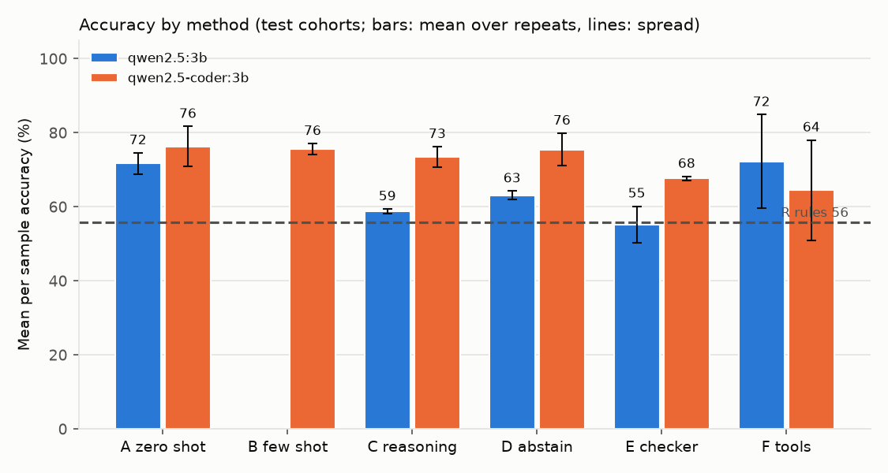
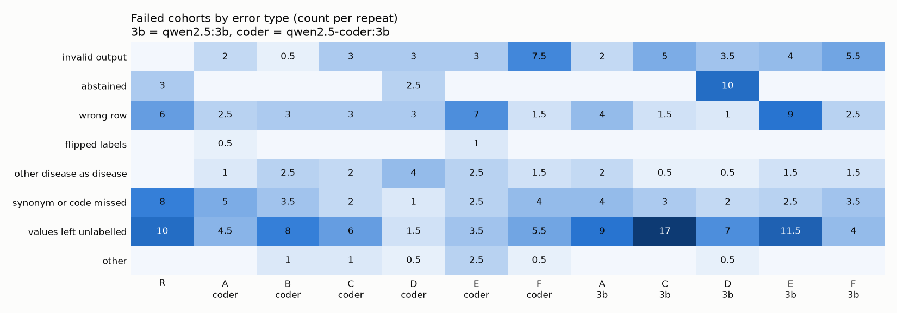

# Why Can't Agents Read the Sample Sheet?

**Research question:** why do LLM agents fail at labelling disease cases and controls from the free
text sample descriptions in public gene expression studies, and which common fixes actually help?

A short paper version of this project is in [`report/report.md`](report/report.md).

## Motivation

Automated gene expression analysis with LLM agents is now close to working end to end, with one
stubborn exception. In GenoTEX ([Liu et al., arXiv 2406.15341](https://arxiv.org/abs/2406.15341))
and GenoMAS ([Liu, Li, and Wang, arXiv 2507.21035](https://arxiv.org/abs/2507.21035)), the step
called **clinical trait extraction** scored about 32%, while other steps did far better:

| Paper | Clinical trait extraction | For contrast |
|---|---|---|
| GenoTEX | about 32.28% | |
| GenoMAS | about 32.61% | gene data preprocessing about 91% |

Clinical trait extraction means reading each sample's short description (`diagnosis: STEMI`,
`tissue: Non-tumour adjacent (liver)`, `genotype: T21`) and deciding whether that sample has the
trait. Every later step depends on these groups being right. GenoMAS improved the overall pipeline
with planning, review, and mixing models, but this step stayed near 32%.

I wanted to isolate this one step, measure it directly, and find out what kind of mistakes agents
make on it. Both papers score it with their own metric (CSC). I did not reimplement CSC, so my
numbers are **not directly comparable** to theirs.

## Approach

### Benchmark

* **50 GEO cohorts across 15 traits, 9355 labelled samples:** 40 test cohorts and 10 development
  cohorts used only for prompt examples and pilots. Details are in
  [`benchmark/DATA_CARD.md`](benchmark/DATA_CARD.md), and a short biology background is in
  [`docs/biology_background.md`](docs/biology_background.md).
* **Inputs:** the sample metadata (title, source name, characteristics rows) from the header of each
  NCBI GEO series matrix file. I stream only the header and never download the expression values.
* **Answer key:** the GenoTEX expert labels (one 0 or 1 per sample, released under CC BY 4.0) and
  the metadata row the experts used, which I read from their released code as text.
* **Selection:** a fixed seed, round robin across traits (at most 4 cohorts per trait), and only
  basic checks (binary labels, at least 3 samples per class). I did not pick cohorts by difficulty.

### Task format

Following how GenoMAS frames the step, the agent sees the trait, the study title, and the distinct
values of every metadata row. It picks **one row** and maps each of its values to `disease`,
`control`, or `unknown`. Code applies that mapping to every sample and grades each sample against
the expert label.

### Methods

| Method | Description |
|---|---|
| R rules | No LLM. Control words first, then trait words, then `trait: yes` style rows |
| A zero shot | Task, cohort, and the JSON answer format |
| B few shot | A plus three solved development examples (run on `qwen2.5-coder:3b` only) |
| C structured reasoning | B plus a checklist (negation, codes, other diseases count as controls) and a short reason before each label |
| D abstention | C plus permission to answer `unsure` per value or `cannot determine` per cohort |
| E extractor plus checker | C, then a second call reviews the answer; one revision if it asks for one |
| F tool calling agent | The model starts without the metadata and calls tools: `list_rows`, `get_row_values` (values with sample counts), `check_mapping` (unlabelled values, values not in the row, a row with one value), `submit_answer`. At most 8 tool calls |

I ran two free local models through Ollama: `qwen2.5:3b` (general) and `qwen2.5-coder:3b` (coding
model). Methods A to E use Ollama's JSON mode; F uses Ollama's native tool calling. All use
temperature 0.3 with a fixed seed per repeat and the same cohort description. I validate every
answer: a row id that does not exist, or a mapping that matches none of the row's values, counts as
an invalid answer. In F, malformed or unknown tool calls, server errors, and timeouts go back to the
model as error messages so it can continue, and an attempt with no valid `submit_answer` within the
budget is invalid. In the development pilot `qwen2.5-coder:3b` wrote its tool calls as JSON text
instead of using the tool interface, so before the test run I added a parser that runs such text
calls and flags them as recovered (`src/agent.py`). Every LLM and tool call is logged in
`results/runs/<run>/calls.jsonl`.

## Results

Three runs on the same 40 test cohorts and seeds, 2 repeats each: `main` (R, A, C, D, E, both
models, 680 attempts, about 3.7 hours), `main_f` (F, both models, 160 attempts), and `main_b`
(B, `qwen2.5-coder:3b`, 80 attempts); F and B together took about 2.2 hours on a laptop. Accuracy
is per sample within each cohort, then averaged over cohorts. ± is the standard deviation across
the 2 repeats, so it is only a rough measure of spread. A cohort counts as solved at 95% accuracy or
more. Full table: [`results/runs/combined/metrics.md`](results/runs/combined/metrics.md).

| Model | Method | Accuracy % | Macro F1 % | Row choice % | Solved (of 40) | Invalid % | Coverage % | Selective acc % |
|---|---|---|---|---|---|---|---|---|
| none | R rules | 55.8 | 60.5 | 77.5 | 13 | 0 | 62.8 | 91.5 |
| qwen2.5:3b | A zero shot | 71.7 ± 2.9 | 71.1 ± 2.8 | 85.0 | 19.0 | 5.0 | 81.7 | 88.6 |
| qwen2.5:3b | C reasoning | 58.8 ± 0.6 | 57.4 ± 2.2 | 83.7 | 13.0 | 12.5 | 63.4 | 91.7 |
| qwen2.5:3b | D abstain | 63.1 ± 1.2 | 65.4 ± 0.4 | 87.5 | 15.5 | 8.8 | 66.2 | 95.8 |
| qwen2.5:3b | E checker | 55.2 ± 4.9 | 54.9 ± 3.8 | 67.5 | 11.5 | 10.0 | 67.8 | 83.3 |
| qwen2.5:3b | F tools | 72.3 ± 12.6 | 74.1 ± 10.8 | 80.0 | 23.0 | 13.8 | 78.4 | 92.0 |
| qwen2.5-coder:3b | A zero shot | **76.3 ± 5.4** | **77.0 ± 5.0** | 88.8 | **24.5** | 5.0 | 82.9 | 92.2 |
| qwen2.5-coder:3b | B few shot | 75.5 ± 1.5 | 77.2 ± 0.7 | 91.3 | 21.5 | 1.2 | 87.5 | 87.0 |
| qwen2.5-coder:3b | C reasoning | 73.5 ± 2.8 | 75.6 ± 2.5 | 85.0 | 23.0 | 7.5 | 81.1 | 90.4 |
| qwen2.5-coder:3b | D abstain | 75.5 ± 4.4 | 76.2 ± 4.9 | 85.0 | 24.5 | 7.5 | 85.4 | 89.0 |
| qwen2.5-coder:3b | E checker | 67.6 ± 0.6 | 64.9 ± 0.5 | 75.0 | 18.0 | 7.5 | 83.2 | 81.1 |
| qwen2.5-coder:3b | F tools | 64.5 ± 13.5 | 64.7 ± 14.3 | 77.5 | 19.5 | 18.8 | 69.6 | 92.4 |

Bold marks the best of the configurations tested, not a clear winner: several other rows are
within its repeat spread.



### Key findings

* **Best of the configurations tested: zero shot with `qwen2.5-coder:3b`,** 76.3% mean accuracy
  against 55.8% for the keyword rule. It solved 24.5 of 40 cohorts, so the step is far from solved
  even here.
* **For `qwen2.5:3b`, zero shot beat structured reasoning.** A beat C, D, and E by more than the
  repeat spread. C was worse than A on 25 of 40 cohorts and better on 10; with that format the model
  left 29% of the values in its chosen row unlabelled, against 11% with zero shot. This finding
  holds for `qwen2.5:3b` only.
* **For `qwen2.5-coder:3b`, the prompt barely mattered.** A, B, C, and D are all within noise of
  each other (73.5 to 76.3). Adding examples alone (B) was better than A on 10 cohorts and worse on
  10. Only E, and F on average, were lower.
* **The coding model scored higher with methods A to E,** clearly so for C, D, and E. For zero shot
  the gap (76.3 against 71.7) is within the repeat spread, so I do not claim a difference there.
* **Abstention traded coverage for precision.** With `qwen2.5:3b`, D was right on 95.8% of the
  samples it labelled (zero shot: 88.6%), but it labelled only 66% of samples, so total accuracy
  stayed below zero shot.
* **The checker hurt.** It asked for a revision in 137 of 146 valid reviews, so it barely told good
  answers from bad ones. Comparing each first answer with its revision, 47 got worse (23 of them
  had been fully correct) and 19 got better. This contrasts with GenoMAS, where review was part of
  what improved the pipeline. My working hypothesis is that a 3B model is too weak to act as a
  checker, but I have not tested that.
* **The tool calling agent fixed the errors it targeted for one model and added new ones.** See the
  next two sections.

### Planned comparison for method F (written before any F results)

Method F is a tool calling agent. Instead of reading all metadata at once, it calls tools to list
the rows, read one row's values with sample counts, check a draft mapping (values left unlabelled,
labels for values that do not exist, a row with only one distinct value), and submit the answer.
These tools target the two largest error types above. I fixed the comparison before running F:

* **Primary:** F against A (zero shot) for each model on the same 40 test cohorts and seeds: mean
  per sample accuracy, macro F1, row choice, solved cohorts, and invalid rate. A difference smaller
  than the repeat spread counts as no difference.
* **Mechanism:** the share of attempts whose main error is "values left unlabelled" and the share
  whose main error is "wrong row", for F against A, using the same categorizer.
* **Agent behaviour:** tool calls per cohort, how often `check_mapping` flagged a problem, and how
  often the submitted answer then passed the same check.
* **Expectation:** F should reduce unlabelled values and wrong rows. It may still lose overall if
  the small models handle tool calls poorly; I will report it either way.

### Method F results

**Primary comparison.** By the rule above, neither model shows a clear accuracy difference between
F and A, because F's repeat spread (12.6 and 13.5 points) is larger than either gap.

| Model | Method | Accuracy % | Macro F1 % | Row choice % | Solved | Invalid % | F better / worse / tied cohorts |
|---|---|---|---|---|---|---|---|
| qwen2.5:3b | A | 71.7 ± 2.9 | 71.1 ± 2.8 | 85.0 | 19.0 | 5.0 | |
| qwen2.5:3b | F | 72.3 ± 12.6 | 74.1 ± 10.8 | 80.0 | 23.0 | 13.8 | 15 / 11 / 14 |
| qwen2.5-coder:3b | A | 76.3 ± 5.4 | 77.0 ± 5.0 | 88.8 | 24.5 | 5.0 | |
| qwen2.5-coder:3b | F | 64.5 ± 13.5 | 64.7 ± 14.3 | 77.5 | 19.5 | 18.8 | 7 / 19 / 14 |

For `qwen2.5:3b` F solved 4 more cohorts on average, but it also produced more invalid answers.
For `qwen2.5-coder:3b` F was worse on 19 cohorts and better on 7, which points the wrong way even
though the mean gap is inside the spread.

**Mechanism** (share of all 80 attempts whose main error is each type,
[`results/runs/combined/mechanism.md`](results/runs/combined/mechanism.md)):

| Model | Method | Values left unlabelled % | Wrong row % | Invalid output % |
|---|---|---|---|---|
| qwen2.5:3b | A | 22.5 | 10.0 | 5.0 |
| qwen2.5:3b | F | **10.0** | **6.2** | 13.8 |
| qwen2.5-coder:3b | A | 11.2 | 6.2 | 5.0 |
| qwen2.5-coder:3b | F | 13.8 | **3.8** | 18.8 |

My expectation held for `qwen2.5:3b`: unlabelled values fell by more than half and wrong rows fell
too. For `qwen2.5-coder:3b` only wrong rows fell. For both models the gain was eaten by a new
failure: every invalid F answer is an attempt that used all 8 tool calls without a valid
`submit_answer`.

**Agent behaviour:**

| Model | Tool calls per cohort | Calls recovered from text | Used `check_mapping` | Flagged a problem | Passed the check after a flag | Submitted answer passes check |
|---|---|---|---|---|---|---|
| qwen2.5:3b | 4.5 | 0% | 74 of 80 | 8 | 1 | 61 of 69 |
| qwen2.5-coder:3b | 5.1 | 100% | 79 of 80 | 28 | 13 | 64 of 65 |

**Why the loop failed.** The two models ran out of budget in different ways:

* `qwen2.5:3b` used the native tool interface, but often answered in plain text without calling a
  tool (45 times in total, 22 of them in the 11 attempts that ran out), or kept reading the same row.
* `qwen2.5-coder:3b` often wrote its whole plan in its first message: `list_rows`, `get_row_values`,
  `check_mapping`, and a `submit_answer` with placeholder keys such as `value1`, before it had seen
  any tool output. That one message used 4 of the 8 calls and the submit was rejected. It happened
  in 27 of 80 attempts, and 12 of its 15 invalid answers came from them. It was also strongly seed
  dependent: 1 of 40 cohorts in repeat 0 and 26 of 40 in repeat 1, where those cohorts averaged
  40.6% accuracy against 81.4% for the rest. That single behaviour explains most of F's spread for
  this model.

## Error analysis

I sorted every failed cohort attempt (accuracy below 95%) into one main error type, in a fixed
priority order (`src/analyze.py`). Counts cover all three runs: both models, methods A to F, both
repeats, and the rule:

| Error type | Failed attempts | What it looks like |
|---|---|---|
| values left unlabelled | 165 | The right row, but some of its values get no label |
| wrong row | 82 | A row with one value (`disease state: HCC`) or a tissue row instead of the case and control row |
| invalid output | 78 | In A to E, mostly a row id that does not match the values written; in F, all 26 are the agent running out of tool calls |
| synonym or code missed | 74 | `diagnosis: STEMI` labelled control for coronary artery disease |
| other disease as disease | 39 | `diagnosis: IEI` labelled disease in an asthma study |
| abstained | 28 | D answered `cannot determine` or `unsure` for most samples |
| other or flipped labels | 15 | |



Three examples (more in
[`results/runs/combined/error_examples.md`](results/runs/combined/error_examples.md)):

* **GSE174570, liver cancer, zero shot, `qwen2.5:3b`, 50%.** The model chose the row
  `disease state: HCC`, which has the same value for every sample and so cannot separate anything.
  The experts used `tissue: Tumour (liver)` against `tissue: Non-tumour adjacent (liver)`. The model
  matched the disease word instead of looking for the row that splits the samples.
* **GSE109048, coronary artery disease, abstention, `qwen2.5:3b`, 67%.** The row was right, but
  `diagnosis: STEMI` was labelled control, with the reason `ST-elevation myocardial infarction`.
  The model expanded the abbreviation correctly and still did not connect a heart attack to
  coronary artery disease.
* **GSE131027, mesothelioma, tool agent, `qwen2.5-coder:3b`, invalid in both repeats.** In repeat 0
  the first message already submitted `{"value1": "disease", "value2": "control", "value3": "unknown"}`
  before any tool had answered. After
  the rejection, the model labelled the row `tissue: tumor biopsy`, and `check_mapping` warned that
  this row has one value for all 92 samples. The model then listed the rows again, chose the same
  row, got the same warning, and ran out of calls. The check found the problem; the model did not
  act on it.

A few expert labels are debatable (for example, lesional skin from a different disease labelled
control in a lupus study). I flag these cohorts in `src/analyze.py` and in the error examples
instead of silently counting them as model mistakes.

## Limitations

* **2 repeats,** so the ± values are rough. Differences smaller than the spread should be read as
  no difference. F's spread is especially large.
* **Method B ran on `qwen2.5-coder:3b` only,** so for `qwen2.5:3b` I still cannot say whether the
  drop from A to C comes from the examples, the reasoning format, or both.
* **F depends on design choices I did not tune:** the 8 call budget, the tool descriptions, and,
  for `qwen2.5-coder:3b`, the parser that recovers tool calls written as text. A larger budget or a
  rule of one tool call per message might change the result.
* **40 test cohorts** across 15 traits.
* **Disease against control only,** and only cohorts where one metadata row explains the labels.
* **3B models only.** Larger models may behave differently, especially with longer prompts, as
  checkers, and as tool users.
* **The metric is not identical to CSC,** so my numbers should not be compared one to one with the
  papers.
* **Possible pretraining exposure:** GEO text is public, so the models may have seen some of these
  studies.
* **Ollama is not fully deterministic** even with a fixed seed; a development cohort gave different
  answers in two runs with the same seed.
* I wrote the rule after seeing the development cohorts, which may flatter it slightly. Pooled
  accuracy in `metrics.md` is dominated by GSE178201 (3984 of 7362 labelled test samples), which is
  why I report the per cohort mean.

## Next steps

* Make the agent loop stricter: allow one tool call per message, and refuse `submit_answer` until
  the model has read that row's values. Both target the two loop failures above.
* Run method B on `qwen2.5:3b` to separate the effect of examples from the effect of the reasoning
  format.
* Use a larger model as the checker, keeping the small extractor, to test the weak checker
  hypothesis.
* Run the benchmark, including F, with a larger model as the extractor.
* Score with the papers' CSC metric for a direct comparison.

## Reproduce

```bash
python -m venv .venv && .venv/Scripts/pip install -r requirements.txt   # Windows path shown
ollama pull qwen2.5:3b && ollama pull qwen2.5-coder:3b
python -m scripts.build_benchmark          # downloads headers and labels, writes benchmark/cohorts
python -m pytest                           # 39 tests
python -m src.run_experiment --run main --cohorts test --methods R,A,C,D,E --repeats 2
python -m src.run_experiment --run main_f --cohorts test --methods F --models qwen2.5-coder:3b,qwen2.5:3b --repeats 2
python -m src.run_experiment --run main_b --cohorts test --methods B --models qwen2.5-coder:3b --repeats 2
python -m src.analyze --run main,main_f,main_b --out combined
python -m scripts.make_figures --run main,main_f,main_b --out combined
```

The runner is resumable: stop it with Ctrl+C and run the same command again to continue. Settings
(context 8192, temperature 0.3, seeds, token cap 1000, the F budget of 8 tool calls) are in
`config.yaml`.

## Credits

* **GenoTEX:** Liu et al., [arXiv 2406.15341](https://arxiv.org/abs/2406.15341). The expert labels
  and trait rows used as my answer key come from the GenoTEX release (Hugging Face
  `Liu-Hy/GenoTEX`), licensed **CC BY 4.0**. I use a small subset and change only its format.
* **GenoMAS:** Liu, Li, and Wang, [arXiv 2507.21035](https://arxiv.org/abs/2507.21035). My task
  format (choose a row, map its values) follows this work.
* **NCBI GEO:** sample metadata comes from public GEO series matrix files.

**Built with** Python, pandas, Ollama, and the Qwen2.5 3B and Qwen2.5 Coder 3B models, with Claude
Code as a coding assistant.
