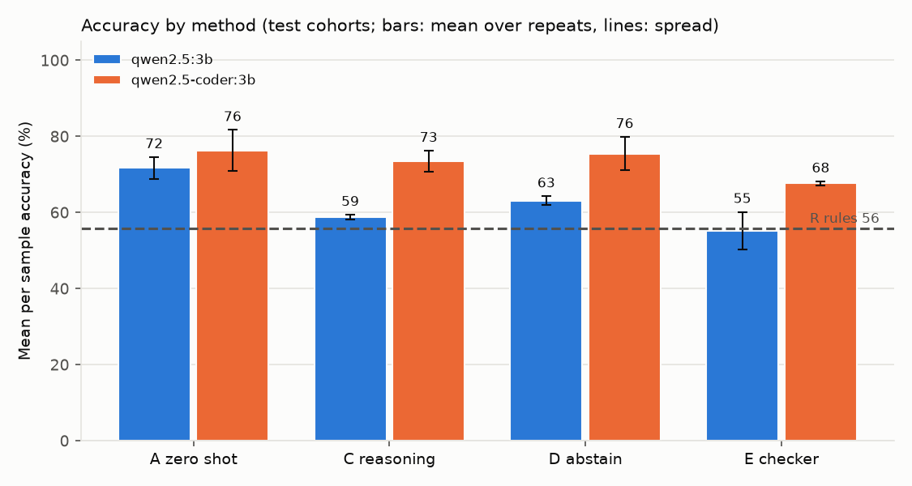
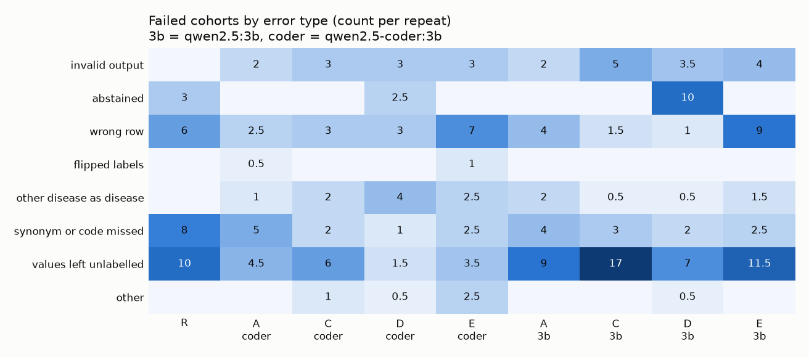

# Why Can't Agents Read the Sample Sheet?

**Research question:** why do LLM agents fail at labelling disease cases and controls from the free
text sample descriptions in public gene expression studies, and which common fixes actually help?

## Motivation

Automated gene expression analysis with LLM agents is now close to working end to end, with one
stubborn exception. In GenoTEX ([Liu et al., arXiv 2406.15341](https://arxiv.org/abs/2406.15341))
and GenoMAS ([Liu, Li, and Wang, arXiv 2507.21035](https://arxiv.org/abs/2507.21035)), the step
called **clinical trait extraction** scored about 32%, while other steps did far better:

| Paper | Clinical trait extraction | For contrast |
|---|---|---|
| GenoTEX | about 32.28% | |
| GenoMAS | about 32.61% | gene data preprocessing about 91% |

Clinical trait extraction means reading each sample's short description (`diagnosis: STEMI`,
`tissue: Non-tumour adjacent (liver)`, `genotype: T21`) and deciding whether that sample has the
trait. Every later step depends on these groups being right. GenoMAS improved the overall pipeline
with planning, review, and mixing models, but this step stayed near 32%.

I wanted to isolate this one step, measure it directly, and find out what kind of mistakes agents
make on it. Both papers score it with their own metric (CSC). I did not reimplement CSC, so my
numbers are **not directly comparable** to theirs.

## Approach

### Benchmark

* **50 GEO cohorts across 15 traits, 9355 labelled samples:** 40 test cohorts and 10 development
  cohorts used only for prompt examples. Details are in
  [`benchmark/DATA_CARD.md`](benchmark/DATA_CARD.md), and a short biology background is in
  [`docs/biology_background.md`](docs/biology_background.md).
* **Inputs:** the sample metadata (title, source name, characteristics rows) from the header of each
  NCBI GEO series matrix file. I stream only the header and never download the expression values.
* **Answer key:** the GenoTEX expert labels (one 0 or 1 per sample, released under CC BY 4.0) and
  the metadata row the experts used, which I read from their released code as text.
* **Selection:** a fixed seed, round robin across traits (at most 4 cohorts per trait), and only
  basic checks (binary labels, at least 3 samples per class). I did not pick cohorts by difficulty.

### Task format

Following how GenoMAS frames the step, the agent sees the trait, the study title, and the distinct
values of every metadata row. It picks **one row** and maps each of its values to `disease`,
`control`, or `unknown`. Code applies that mapping to every sample and grades each sample against
the expert label.

### Methods

| Method | Description |
|---|---|
| R rules | No LLM. Control words first, then trait words, then `trait: yes` style rows |
| A zero shot | Task, cohort, and the JSON answer format |
| B few shot | A plus three solved development examples (pilot only, not in the main run) |
| C structured reasoning | B plus a checklist (negation, codes, other diseases count as controls) and a short reason before each label |
| D abstention | C plus permission to answer `unsure` per value or `cannot determine` per cohort |
| E extractor plus checker | C, then a second call reviews the answer; one revision if it asks for one |

I ran two free local models through Ollama: `qwen2.5:3b` (general) and `qwen2.5-coder:3b` (coding
model). All methods use Ollama's JSON mode, temperature 0.3 with a fixed seed per repeat, and the
same cohort description. I validate every answer: a row id that does not exist, or a mapping that
matches none of the row's values, counts as an invalid answer. Every LLM call is logged in
`results/runs/<run>/calls.jsonl`.

## Results

Main run: 40 test cohorts, both models, 2 repeats, methods R, A, C, D, E. That is 680 attempts and
about 3.7 hours of model time on a laptop. Accuracy is per sample within each cohort, then averaged
over cohorts. ± is the standard deviation across the 2 repeats, so it is only a rough measure of
spread. A cohort counts as solved at 95% accuracy or more. Full table:
[`results/runs/main/metrics.md`](results/runs/main/metrics.md).

| Model | Method | Accuracy % | Macro F1 % | Row choice % | Solved (of 40) | Invalid % | Coverage % | Selective acc % |
|---|---|---|---|---|---|---|---|---|
| none | R rules | 55.8 | 60.5 | 77.5 | 13 | 0 | 62.8 | 91.5 |
| qwen2.5:3b | A zero shot | **71.7 ± 2.9** | **71.1 ± 2.8** | 85.0 | **19.0** | 5.0 | 81.7 | 88.6 |
| qwen2.5:3b | C reasoning | 58.8 ± 0.6 | 57.4 ± 2.2 | 83.7 | 13.0 | 12.5 | 63.4 | 91.7 |
| qwen2.5:3b | D abstain | 63.1 ± 1.2 | 65.4 ± 0.4 | 87.5 | 15.5 | 8.8 | 66.2 | **95.8** |
| qwen2.5:3b | E checker | 55.2 ± 4.9 | 54.9 ± 3.8 | 67.5 | 11.5 | 10.0 | 67.8 | 83.3 |
| qwen2.5-coder:3b | A zero shot | **76.3 ± 5.4** | **77.0 ± 5.0** | 88.8 | **24.5** | 5.0 | 82.9 | 92.2 |
| qwen2.5-coder:3b | C reasoning | 73.5 ± 2.8 | 75.6 ± 2.5 | 85.0 | 23.0 | 7.5 | 81.1 | 90.4 |
| qwen2.5-coder:3b | D abstain | 75.5 ± 4.4 | 76.2 ± 4.9 | 85.0 | **24.5** | 7.5 | 85.4 | 89.0 |
| qwen2.5-coder:3b | E checker | 67.6 ± 0.6 | 64.9 ± 0.5 | 75.0 | 18.0 | 7.5 | 83.2 | 81.1 |



### Key findings

* **The simplest prompt was best.** For `qwen2.5:3b`, zero shot beat every longer method by more
  than the repeat spread. Adding examples and a reasoning format (C) was worse on 25 of 40 cohorts
  and better on 10. With that format the model left 29% of the values in its chosen row
  unlabelled, against 11% with zero shot. For `qwen2.5-coder:3b`, A, C, and D are within noise of
  each other; only E is clearly lower.
* **The coding model beat the general model.** It scored higher with every method. The gap is 12
  to 15 points for C, D, and E, but for zero shot (76.3 against 71.7) it is within the repeat
  spread, so I do not claim a difference there.
* **Abstention traded coverage for precision.** With `qwen2.5:3b`, D was right on 95.8% of the
  samples it labelled (zero shot: 88.6%), but it labelled only 66% of samples, so total accuracy
  stayed below zero shot.
* **The checker hurt.** It asked for a revision in 137 of 146 valid reviews, so it barely told good
  answers from bad ones. Comparing each first answer with its revision, 47 got worse (23 of them
  had been fully correct) and 19 got better. This contrasts with GenoMAS, where review was part of
  what improved the pipeline. My working hypothesis is that a 3B model is too weak to act as a
  checker, but I have not tested that; a larger checker model is the obvious next experiment.

## Error analysis

### Planned comparison for method F (written before any F results)

Method F is a tool calling agent. Instead of reading all metadata at once, it calls tools to list
the rows, read one row's values with sample counts, check a draft mapping (values left unlabelled,
labels for values that do not exist, a row with only one distinct value), and submit the answer.
These tools target the two largest error types above. I fixed the comparison before running F:

* **Primary:** F against A (zero shot) for each model on the same 40 test cohorts and seeds: mean
  per sample accuracy, macro F1, row choice, solved cohorts, and invalid rate. A difference smaller
  than the repeat spread counts as no difference.
* **Mechanism:** the share of attempts whose main error is "values left unlabelled" and the share
  whose main error is "wrong row", for F against A, using the same categorizer.
* **Agent behaviour:** tool calls per cohort, how often `check_mapping` flagged a problem, and how
  often the submitted answer then passed the same check.
* **Expectation:** F should reduce unlabelled values and wrong rows. It may still lose overall if
  the small models handle tool calls poorly; I will report it either way.

## Error analysis

I sorted every failed cohort attempt (accuracy below 95%) into one main error type, in a fixed
priority order (`src/analyze.py`). Counts cover all models, methods, and repeats, including the
rule:

| Error type | Failed attempts | What it looks like |
|---|---|---|
| values left unlabelled | 130 | The right row, but some of its values get no label |
| wrong row | 68 | A row with one value (`disease state: HCC`) or a tissue row instead of the case and control row |
| synonym or code missed | 52 | `diagnosis: STEMI` labelled control for coronary artery disease |
| invalid output | 51 | Mostly a row id that does not match the values written; in 19 cases the values came exactly from another real row |
| abstained | 28 | D answered `cannot determine` or `unsure` for most samples |
| other disease as disease | 28 | `diagnosis: IEI` labelled disease in an asthma study |
| other or flipped labels | 12 | |



Two examples (more in [`results/runs/main/error_examples.md`](results/runs/main/error_examples.md)):

* **GSE174570, liver cancer, zero shot, `qwen2.5:3b`, 50%.** The model chose the row
  `disease state: HCC`, which has the same value for every sample and so cannot separate anything.
  The experts used `tissue: Tumour (liver)` against `tissue: Non-tumour adjacent (liver)`. The model
  matched the disease word instead of looking for the row that splits the samples.
* **GSE109048, coronary artery disease, abstention, `qwen2.5:3b`, 67%.** The row was right, but
  `diagnosis: STEMI` was labelled control, with the reason "ST-elevation myocardial infarction".
  The model expanded the abbreviation correctly and still did not connect a heart attack to
  coronary artery disease.

A few expert labels are debatable (for example, lesional skin from a different disease labelled
control in a lupus study). I flag these cohorts in `src/analyze.py` and in the error examples
instead of silently counting them as model mistakes.

## Limitations

* **2 repeats,** so the ± values are rough. Differences smaller than the spread should be read as
  no difference.
* **Method B was not in the main run** because of the time budget (see
  [`results/runs/pilot/ESTIMATE.md`](results/runs/pilot/ESTIMATE.md)), so I cannot say whether the
  drop from A to C comes from the examples, the reasoning format, or both.
* **40 test cohorts** across 15 traits.
* **Disease against control only,** and only cohorts where one metadata row explains the labels.
* **3B models only.** Larger models may behave differently, especially with longer prompts and as
  checkers.
* **The metric is not identical to CSC,** so my numbers should not be compared one to one with the
  papers.
* **Possible pretraining exposure:** GEO text is public, so the models may have seen some of these
  studies.
* I wrote the rule after seeing the development cohorts, which may flatter it slightly. Pooled
  accuracy in `metrics.md` is dominated by GSE178201 (3984 of 7362 labelled test samples), which is
  why I report the per cohort mean.

## Next steps

* Run method B to separate the effect of examples from the effect of the reasoning format.
* Use a larger model as the checker, keeping the small extractor, to test the weak checker
  hypothesis.
* Run the benchmark with a larger hosted model as the extractor.
* Force complete mappings (ask again for values left out), and show the agent how many samples each
  value covers. These target the two largest error types.
* Score with the papers' CSC metric for a direct comparison.

## Reproduce

```bash
python -m venv .venv && .venv/Scripts/pip install -r requirements.txt   # Windows path shown
ollama pull qwen2.5:3b && ollama pull qwen2.5-coder:3b
python -m scripts.build_benchmark          # downloads headers and labels, writes benchmark/cohorts
python -m pytest                           # 24 tests
python -m src.run_experiment --run main --cohorts test --methods R,A,C,D,E --repeats 2
python -m src.analyze --run main
python -m scripts.make_figures --run main
```

The runner is resumable: stop it with Ctrl+C and run the same command again to continue. Settings
(context 8192, temperature 0.3, seeds, token cap 1000) are in `config.yaml`.

## Credits

* **GenoTEX:** Liu et al., [arXiv 2406.15341](https://arxiv.org/abs/2406.15341). The expert labels
  and trait rows used as my answer key come from the GenoTEX release (Hugging Face
  `Liu-Hy/GenoTEX`), licensed **CC BY 4.0**. I use a small subset and change only its format.
* **GenoMAS:** Liu, Li, and Wang, [arXiv 2507.21035](https://arxiv.org/abs/2507.21035). My task
  format (choose a row, map its values) follows this work.
* **NCBI GEO:** sample metadata comes from public GEO series matrix files.

**Built with** Python, pandas, Ollama, and the Qwen2.5 3B and Qwen2.5 Coder 3B models, with Claude
Code as a coding assistant.
